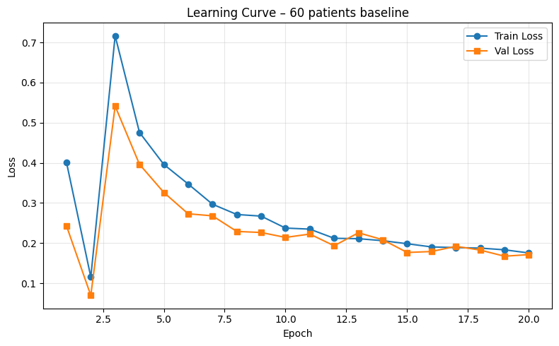

# Liver Segmentation

A project exploring binary liver segmentation in abdominal CT with a 2D U-Net implemented in PyTorch.

This repository presents the method and recorded experimental results. Original notebooks, patient scans, masks, datasets and model checkpoints are not distributed here.

## Method

- Index memory-mapped AbdomenAtlas NPY volumes and select 60 patients (18,753 axial slices).
- Clip CT intensities to [-1000, 1000] HU, normalize each slice, and resize images/masks to 256 × 256.
- Train a custom U-Net with skip connections, Adam, and a combined binary cross-entropy and Dice loss for 20 epochs.
- Save checkpoints using validation Dice and inspect predicted masks.

## Recorded results

| Measure | Recorded value |
| --- | ---: |
| Training slices | 15,002 |
| Validation slices | 3,751 |
| Best validation Dice | 0.9184 (epoch 2) |
| Final validation Dice | 0.5486 (epoch 20) |

These values come from the saved notebook outputs; training was not independently rerun when preparing this project page.

## Evaluation limits

The 80/20 split is by slice, rather than by patient. Slices from the same patient may therefore appear in both subsets. The validation result does not establish performance on unseen patients. The reported score averages batch-level mean Dice scores, and training was unstable after the best early checkpoint. No independent patient-level test or clinical validation is demonstrated.

## Tools

Python · PyTorch · NumPy · pandas · Matplotlib

## Source evidence

Prepared from `assignment-2-liver-segmentation.ipynb`: dataset/split in cells 2–9, architecture/loss in cells 13 and 16, training and the exported loss figure in cell 18 (zero-based cell indices).
